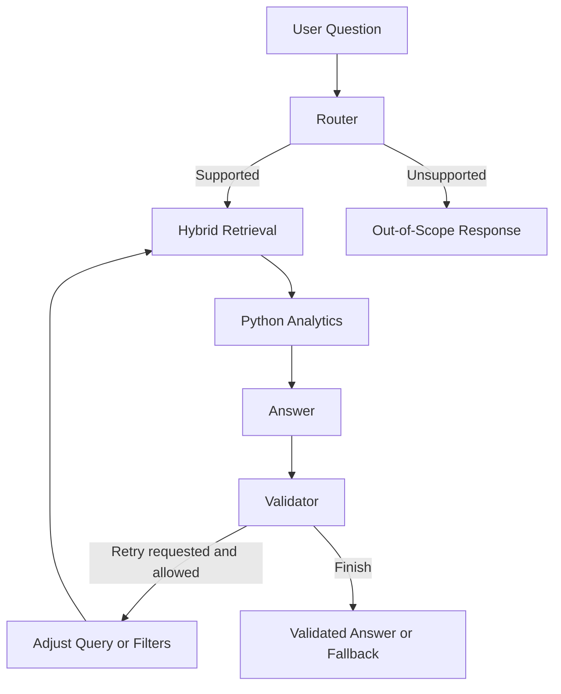

# Laparoscopic Surgery Agentic RAG

A **LangGraph-based assistant for querying laparoscopic surgery event logs**, combining hybrid retrieval, Python analytics, grounded answer generation, and a bounded validation–retry workflow.

The project extends a notebook-based surgery-log RAG pipeline into modular Python components that classify questions, retrieve relevant evidence, calculate duration statistics, and validate responses.

## What It Does

- Answers factual questions about recorded cases, instruments, surgery timing, and pedal activity using retrieved log evidence.
- Extracts metadata filters such as surgery type, surgeon, case ID, source file, and chunk type.
- Combines **FAISS semantic search** and **BM25 keyword search** using **Reciprocal Rank Fusion (RRF)**.
- Calculates duration totals, averages, minimums, maximums, and case counts using Python over retrieved cases.
- Validates answers and can retry retrieval once by rewriting the query, relaxing filters, or expanding the candidate pool.
- Returns an explicit fallback when the available evidence does not support an answer.

## Architecture



| Component | Responsibility |
| --- | --- |
| **Router** | Classifies intent and extracts operation, filters, case limit, and requested ordering through structured output. |
| **Retriever** | Filters metadata, runs FAISS and BM25 searches, merges rankings with RRF, and builds the answer context. |
| **Analytics** | Extracts unique cases with usable durations and performs supported calculations in Python. |
| **Answer** | Formats supported aggregation results directly; uses the LLM for other evidence-based answers. |
| **Validator** | Accepts available deterministic aggregation results directly; otherwise uses structured LLM validation for groundedness, evidence sufficiency, and unsupported claims. |
| **Rewriter** | Applies the selected recovery action while enforcing the retry limit. |
| **Finish** | Returns the answer only when validation flags indicate sufficient, grounded evidence without detected hallucination; otherwise returns the fallback. |

All nodes share a typed workflow state. Router, answer, validator, and rewriter reuse one configured Groq LLM client; separate models are not required.

## Technology Stack

| Area | Technology |
| --- | --- |
| Workflow orchestration | LangGraph |
| LLM integration | LangChain + Groq |
| Embeddings | `sentence-transformers/all-mpnet-base-v2` — 768 dimensions |
| Semantic retrieval | FAISS |
| Keyword retrieval | `rank-bm25` |
| Rank fusion | RRF |
| Data processing | pandas, NumPy |
| Structured output | Pydantic |
| Configuration | python-dotenv |
| Optional tracing | LangSmith |

## Source Layout

| Path | Purpose |
| --- | --- |
| `src/config.py` | Paths, environment settings, retrieval parameters, and retry configuration |
| `src/llm.py` | Shared Groq LLM client |
| `src/prompts.py` | Router, answer, validator, and rewriter prompts |
| `src/retrieval.py` | Metadata filtering, FAISS, BM25, RRF, and context construction |
| `src/agents/state.py` | Shared `SurgeryRAGState` definition |
| `src/agents/router.py` | Intent classification and metadata extraction |
| `src/agents/retriever.py` | Retrieval node |
| `src/agents/analytics.py` | Duration analytics node |
| `src/agents/answer.py` | Answer generation and aggregation formatting |
| `src/agents/validator.py` | Validation and retry routing |
| `src/agents/rewriter.py` | Query rewriting and retrieval recovery |
| `src/agents/graph.py` | Graph construction and `ask_surgery_rag()` entry point |
| `src/tools/analytics.py` | Duration parsing, deduplication, case selection, and calculations |

Historical notebooks cover JSON preprocessing, metadata/chunk creation, retrieval experiments, answer generation, and evaluation. Reviewed notebooks may be included separately.

## Local Setup

Use **Python 3.10 or newer**. Run the following commands from the repository root on Linux/macOS:

```bash
python3 -m venv .venv
source .venv/bin/activate
python -m pip install -r requirements.txt
cp .env.example .env
```

Configure your local `.env`:

```dotenv
GROQ_API_KEY=your_groq_api_key
GROQ_MODEL=openai/gpt-oss-20b

LANGSMITH_TRACING=false
LANGSMITH_API_KEY=
LANGSMITH_PROJECT=surgery-agentic-rag
```

`GROQ_MODEL` is configurable; the value above reflects the source configuration. Use a model available to your Groq account. Enable tracing only when appropriate for the data being processed. Keep real credentials out of Git.

The accompanying requirements are derived from source imports; dependency versions have not been validated as a reproducible lockfile.

### Prepare Local Retrieval Artifacts

Private surgery records and generated retrieval artifacts are excluded from version control. Supply authorized local artifacts or generate replacements from synthetic data before running:

| Local path | Requirement |
| --- | --- |
| `vector_store/surgery_logs_faiss.index` | Required FAISS index |
| `vector_store/surgery_logs_metadata.csv` | Required retrieval metadata and chunk text |
| `vector_store/surgery_logs_embeddings.npy` | Used for filtered vector search; a fallback search path exists without it |
| `data/processed_surgery_rag_data/rag_chunks_metadata.csv` | Required by the configuration validation command |

The preprocessing/retrieval notebooks contain the earlier artifact-generation workflows. Adapt their input paths to your own data. Metadata rows and embeddings must remain aligned, and the index must use the same embedding model and normalization as query encoding.

## Run the Assistant

Validate the local configuration:

```bash
python -m src.config
```

Run the graph's built-in example and debugging output:

```bash
python -m src.agents.graph
```

Or call the assistant from Python:

```python
from src.agents.graph import ask_surgery_rag

result = ask_surgery_rag(
    "Which instruments were used during Cholecystectomy?"
)

print(result["final_answer"])
print(result.get("validation_reason"))
print(result.get("retry_count"))
```

## Example Questions

- Which instruments were used during Cholecystectomy?
- What was the recorded surgery duration for case `<case_id>`?
- What was the clutch pedal activity for case `<case_id>`?
- What is the average recorded duration across the retrieved matching cases?
- Which retrieved matching case had the longest recorded duration?

The router also extracts first/latest N case requests. Correct chronological selection remains a known implementation gap, described below.

## Retrieval and Retry Settings

| Setting | Current value |
| --- | --- |
| Final retrieved chunks | 5 |
| Candidates per retriever, initial attempt | 20 |
| Candidates per retriever, retry | 30 |
| RRF constant | 60 |
| Maximum retries | 1 |
| LLM temperature | 0.1 |

These settings are defined in `src/config.py`. A retry increases the candidate pool and may also rewrite the query or relax a metadata filter. Case IDs and source-file filters are preserved by the filter-relaxation helper.

## Current Limitations

- **Aggregation coverage:** analytics runs over the final top-5 retrieved chunks. Results may omit matching cases and should not be interpreted as exhaustive dataset-wide totals or counts.
- **Chronological selection:** `get_case_durations()` does not carry `surgery_started` into the case records consumed by `select_cases()`. First/latest N selection therefore needs correction. Ordering by `surgery_stopped` is not implemented in the selection helper.
- **Analytics scope:** deterministic tools currently cover case-duration statistics. Instrument/pedal aggregation and comparisons do not yet have equivalent calculation tools.
- **Validation scope:** the analytics validation shortcut accepts available calculated fields; it does not independently establish retrieval completeness or correct chronological selection. LLM validation also does not guarantee factual correctness.
- **Evaluation status:** historical evaluation workflows predate the latest graph changes. Their scores are not presented as verified performance for the current Agentic RAG implementation.

## Data Handling

Keep private surgery logs, case metadata, query logs, evaluation records, embeddings, and credentials outside the public repository. Review notebook code and Markdown cells as well as outputs before publishing. Embeddings and retrieval metadata should be treated as derived private data.

The assistant is designed to analyze recorded workflow information. Its prompts restrict answers to available evidence and exclude clinical advice.

## Next Steps

- Query the full filtered case table for aggregate questions.
- Preserve and parse timestamps before chronological case selection.
- Add deterministic instrument, pedal, and comparison tools.
- Evaluate the current graph for retrieval quality, groundedness, numerical accuracy, retry behavior, and latency.
- Add synthetic sample data for a reproducible public demonstration.
