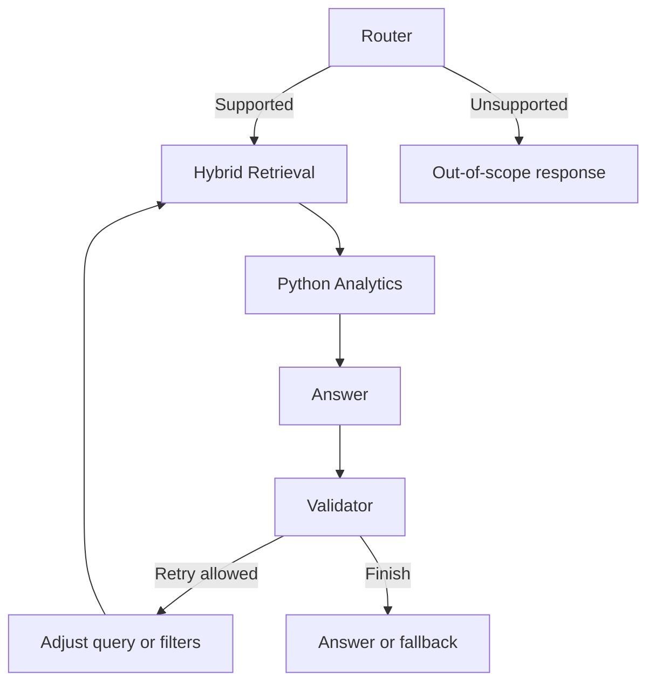

# Laparoscopic Surgery Agentic RAG

A LangGraph workflow for answering questions about laparoscopic surgery event logs, using metadata filtering, hybrid retrieval, grounded answer generation and Python duration analytics.

## Workflow



- Router extracts query type, operation, metadata filters, case limit and ordering.
- Retrieval combines all-mpnet-base-v2 embeddings with FAISS semantic search and BM25 keyword search using reciprocal rank fusion (RRF).
- Analytics deduplicates retrieved cases and calculates duration sums, averages, minimums, maximums and counts in Python.
- Answer generation uses deterministic templates for supported aggregations; other questions use the configured Groq model.
- Validation accepts supported analytics directly and uses an LLM for other answers. One retry may rewrite the query, relax filters or increase retrieval candidates.
- The finish node returns an answer only when validation marks it grounded, sufficient and free of detected hallucination; otherwise it returns a fallback.

## Project files

| Path | Purpose |
| --- | --- |
| `src/config.py` | Paths, retrieval settings and environment configuration |
| `src/llm.py` | Shared Groq LLM client |
| `src/prompts.py` | Router, answer, validator and rewriter prompts |
| `src/retrieval.py` | FAISS, BM25, metadata filtering and RRF |
| `src/agents/graph.py` | Graph construction and `ask_surgery_rag()` entry point |
| `src/agents/state.py` | Shared workflow state |
| `src/agents/` | Router, retrieval, analytics, answer, validator and rewriter nodes |
| `src/tools/analytics.py` | Duration parsing, case selection and calculation helpers |
| `notebooks/` | Historical preprocessing, retrieval and evaluation experiments; publish reviewed copies only |

## Local setup

Use Python 3.10 or newer; the uploaded source uses Python 3.10 union syntax. These instructions target Linux/macOS.

```bash
python3 -m venv .venv
source .venv/bin/activate
python -m pip install -r requirements.txt
cp .env.example .env
```

Set `GROQ_API_KEY` and, if needed, `GROQ_MODEL` in your local `.env`. The example model name reflects the uploaded configuration; set it to a model available to your account. Tracing is disabled in the example environment.

The dependency list comes from source imports and has not been tested as a fresh installation. Preserve a dependency lock from your working environment after validating it.

## Required local artifacts

Private surgery data and its derived retrieval artifacts are excluded from Git. The repository does not run as a complete public demo without these files or replacement synthetic artifacts:

| Local path | Used for |
| --- | --- |
| `data/processed_surgery_rag_data/rag_chunks_metadata.csv` | Configuration validation |
| `vector_store/surgery_logs_faiss.index` | Required FAISS index |
| `vector_store/surgery_logs_metadata.csv` | Required retrieval metadata, including chunk text |
| `vector_store/surgery_logs_embeddings.npy` | Filtered semantic search; optional fallback exists without it |

The historical notebooks contain preprocessing and index-building workflows. Adapt their local input paths to authorized data. Keep embeddings and metadata rows aligned, and use the same embedding model and normalization when rebuilding the index.

## Run from the repository root

```bash
python -m src.config
python -m src.agents.graph
```

The second command runs the question currently configured in `graph.py` and prints debug results.

Programmatic use:

```python
from src.agents.graph import ask_surgery_rag

result = ask_surgery_rag(
    "Which instruments were used during Cholecystectomy?"
)
print(result["final_answer"])
```

## Current implementation limits

- Retrieval passes the top 5 chunks to analytics. Dataset-wide aggregates may be incomplete because this is not an exhaustive query over all matching cases.
- `get_case_durations()` drops timestamps before `select_cases()` sorts by `surgery_started`. First/latest N case selection therefore needs correction. Sorting by `surgery_stopped` is extracted by the router but not implemented by the selection helper.
- Analytics currently handles case-duration operations. Instrument/pedal aggregates and comparisons do not have equivalent deterministic analytics implementations.
- The analytics validator accepts available calculated fields; it does not independently verify full dataset coverage or chronological case selection.
- Existing evaluation notebooks/results predate this graph update. This source review does not establish current Agentic RAG benchmark scores.

## Publication notes

Keep `.env`, patient/surgeon case records, source logs, retrieval metadata, embeddings, evaluation records and query logs private. Notebook outputs and hardcoded cells can contain the same information and must be reviewed before publishing. No license is assumed for this code or the underlying data; add a license only when you have the necessary rights.
